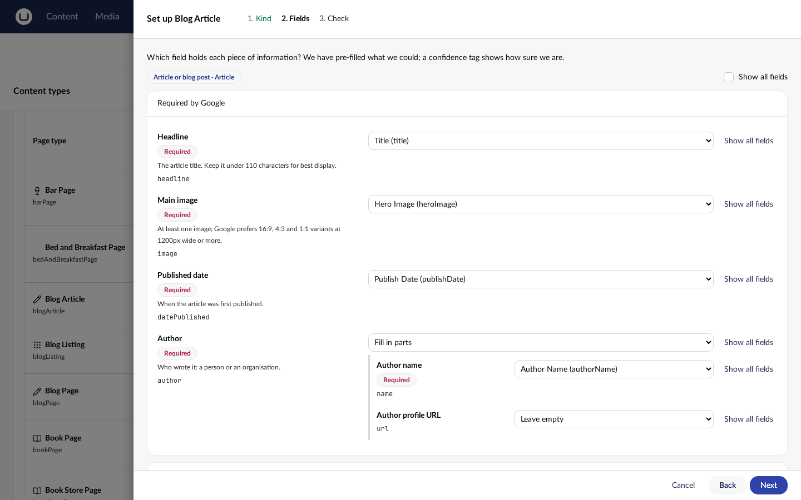
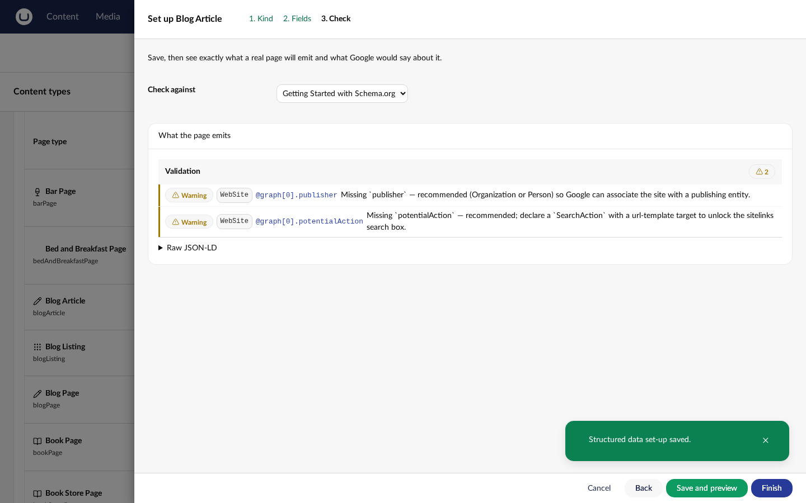

# Quick Start for SEOs

You do not need to write code to use SchemeWeaver. With the **SchemeWeaver SEO** package
installed you get an **SEO Schema** section in the backoffice; without it, the developer
package still lets you map page types from Settings (see the second half of this page).

## What SchemeWeaver does

Search engines understand pages better when the page carries structured data: a machine-readable
summary saying "this page is a recipe, it takes 45 minutes, here is the rating". Structured data
is what makes pages eligible for rich results: star ratings, recipe cards, event listings and job
listings in Google.

SchemeWeaver generates that structured data (JSON-LD, the format Google recommends) from your
existing Umbraco content. You say once what each page type *is* and which fields matter; from
then on every page of that type carries correct, up-to-date structured data, in the same
connected-graph shape that tools like Yoast produce.

## With the SEO Schema section

Ask your developer to install `Umbraco.Community.SchemeWeaver.Seo` and to grant the **SEO
Schema** section to your user group. Then:

### 1. Say who the site represents

Open **SEO Schema › Site identity**. Choose organisation or person, enter the name, add the logo
and your social profile links, and save.

 This becomes the publisher of every page and powers the
organisation panel in search results. If you run a local business, switch on **This is a local
business** and add the address and opening hours.

### 2. Set up each page type

Open **SEO Schema › Content types**. Each row is a page type with a status. Select **Set up** and:

1. **Kind**: pick what a page of this type is. Be specific (a blog post rather than a web page);
   specific kinds unlock specific rich results. Kinds Google no longer rewards are hidden behind
   a toggle.
2. **Fields**: confirm which field holds each piece of information. Required fields are marked;
   we pre-fill what we can and show how confident we are. Pick a field, a fixed value, or the site
   identity (for publisher, organiser, employer and so on).
3. **Check**: save, then see exactly what a real page emits and what Google would say about it.

The status column tells you what is left: **Set up**, **Needs attention** (a required field is
empty, or the kind is retired) or **Not set up**.

### 3. Check individual pages

Open any page in **Content** and select its **Schema** tab. It shows what the page says about
itself in plain language, the validation checklist and the raw JSON-LD, with a button to test the
live page in Google's Rich Results Test. Switch **Page type** to a more precise kind (an article
that is really a news article) or **Exclude this page** when it should carry no structured data.

### 4. Keep an eye on the site

**SEO Schema › Overview** lists what is set up, what needs attention and runs a site health
check: one page of every set-up type is rendered and checked against Google's rules.

## Without the SEO Schema section

With only the developer package installed you map page types from **Settings › Document
Types**:

1. Open the page type and its **Schema.org** tab, select **Map to Schema.org**.
2. Choose what this page type *is*. The picker suggests common types; you can search for
   anything.
3. Select **Auto-map**, review the suggested field mappings and their confidence tags, and save.

Every page of a mapped type now carries structured data. Open any page's **JSON-LD** tab in
Content to see what ships, with the same validation report.

## Which rich results can you target?

| You publish | Kind / type | Google feature |
|---|---|---|
| Articles, blog posts, news | Article, BlogPosting, NewsArticle | Article rich results, Top Stories eligibility |
| Products | Product with offers and reviews | Price, availability, stars in listings |
| Recipes | Recipe | Recipe cards with image, rating, cook time |
| Events | Event | Event listings with date and venue |
| Job vacancies | JobPosting | Google for Jobs |
| Local businesses, restaurants, clinics | LocalBusiness and subtypes | Knowledge panel, local pack details |
| Videos | VideoObject | Video rich results |
| Courses | Course | Course listings |
| People | ProfilePage | Profile page results |
| Software and apps | SoftwareApplication | Software app results |

Structured data makes pages *eligible* for rich results; Google decides when to show them.
Correct markup is the part you control.

## Next steps

- [SchemeWeaver SEO](seo-edition.md): everything the section does, permissions and configuration
- [Mapping Content Types](mapping-content-types.md): the developer mapping workflow in full
- [Quick Start for Developers](quickstart-developer.md): the technical half of the setup
