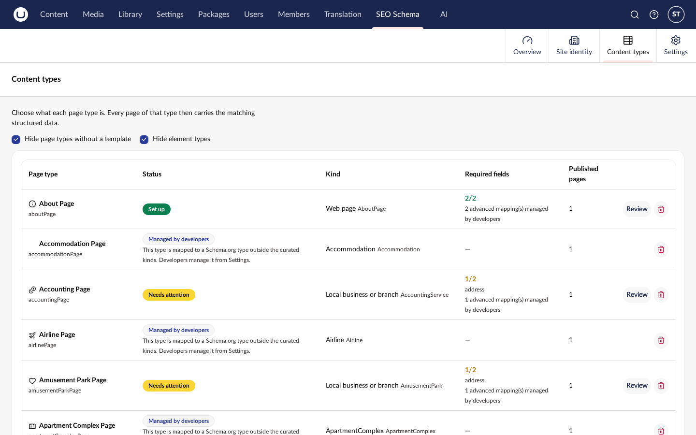
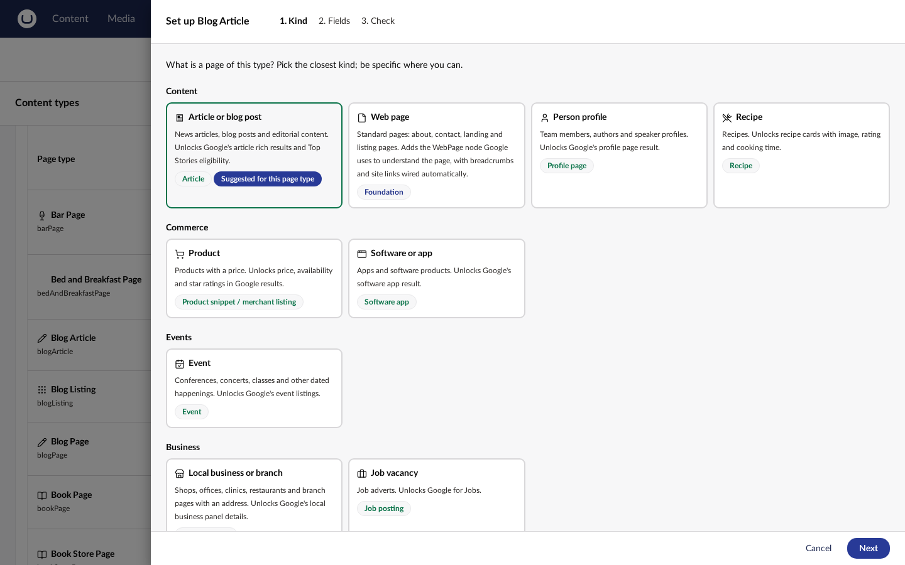
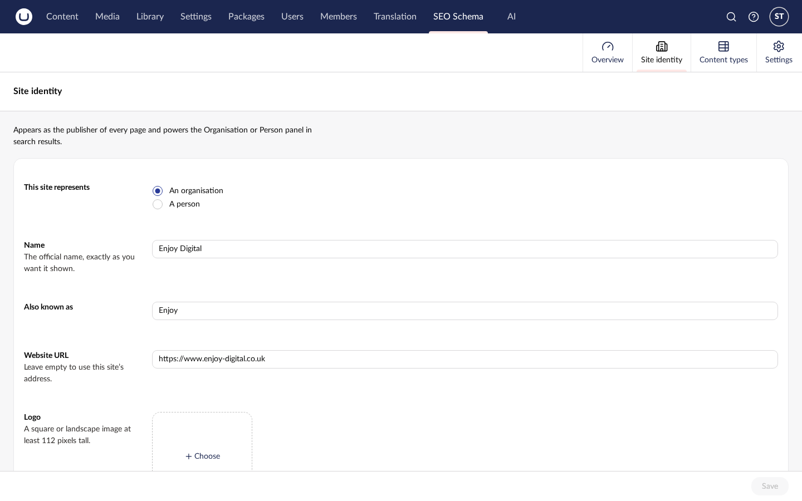
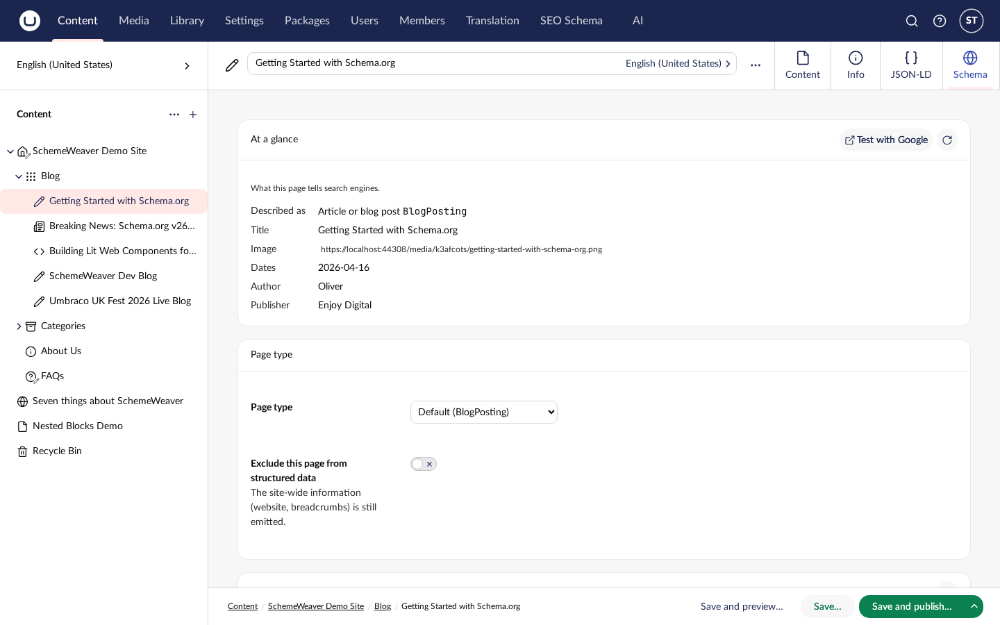
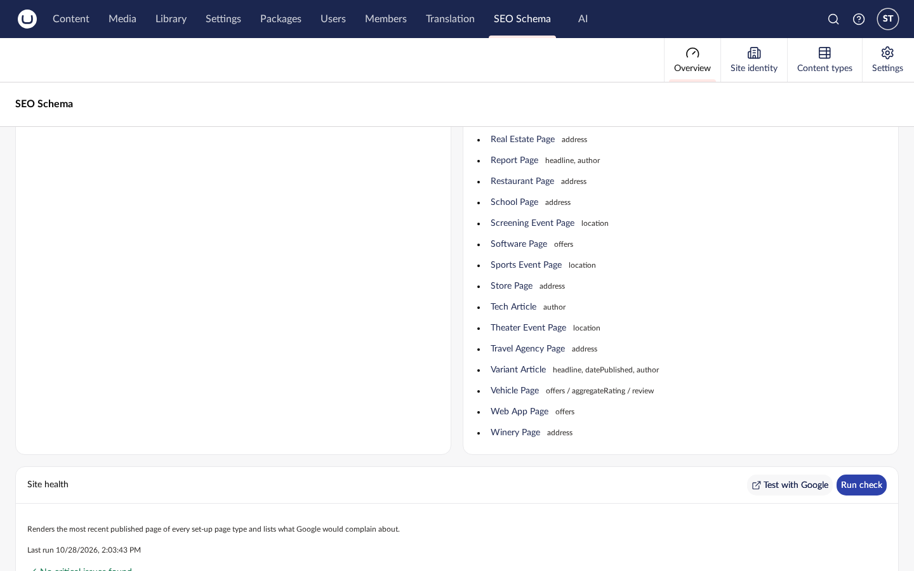

# SchemeWeaver SEO

`Umbraco.Community.SchemeWeaver.Seo` is the edition of SchemeWeaver built for SEOs and editors
rather than developers. It adds an **SEO Schema** section to the backoffice, modelled on the way
Yoast SEO handles structured data in WordPress:

1. **Site identity**: who the site represents (an organisation or a person), its logo and
   social profiles. Emitted as the publisher of every page.
2. **Content types**: a curated list of *kinds* (article, product, event, recipe, job vacancy,
   local business, video, course, software app, profile page, web page) that each page type is
   set up as, through a three-step wizard that shows only the fields Google requires or
   recommends.
3. **Pages**: a "Schema" tab on every content item that explains what the page emits, lets an
   editor switch the page type to a more precise one (an article page becomes a news article)
   or exclude the page, and shows the validation checklist.

It needs no document-type changes, no uSync and no code. The developer package keeps working
alongside it on the very same mappings.



## Installation

```bash
dotnet add package Umbraco.Community.SchemeWeaver.Seo
```

The core package is installed as a dependency. Restart the site; the migration creates one table
(`SchemeWeaverSeoPageOverride`) and, on first start, the **SEO Schema** section is granted to the
Administrators user group so somebody can see it straight away.

### Giving SEOs access

Open **Users › User Groups**, pick (or create) a group such as "SEO", and tick **SEO Schema**
under its sections. Members of that group see the section and may call its API; they need no
access to Settings. The API checks the section permission on every request, not a login claim,
so a freshly granted user does not have to sign out.

Set `SchemeWeaver:Seo:GrantSectionToAdministrators` to `false` to skip the automatic grant.

## How it relates to the developer package

The SEO edition never has a model of its own. A kind is a Schema.org type plus a list of
**slots**, and each slot is one Schema.org property. Saving the wizard writes ordinary
SchemeWeaver property-mapping rows, exactly as the Schema.org tab on the document type would,
so:

- the generator, the validator, the Delivery API, the tag helper and the MCP tools are untouched;
- a developer can open **Settings › Document Types › Schema.org** and see (or refine) what the
  SEO set up;
- rows a developer added that the kind does not know about are preserved and shown read-only
  in the wizard as "advanced mappings (managed by developers)";
- a mapping to a type outside the curated kinds shows as **Managed by developers** in the
  Content types view and is left alone.

Two small seams in the core make the per-page and identity features possible:
`ISiteIdentityProvider` (consumed by the Organization and WebSite graph pieces) and
`IContentMappingOverrideProvider` (consulted by the generator before it picks a type). See
[Extending SchemeWeaver](extending.md#satellite-seams).

## The curated kinds



The catalogue ships inside the package as `Templates/catalogue.json`. Each kind lists its
required and recommended slots; the required slots are kept identical to the Critical checks
of the core's Google rich-result rules by a unit test, so the wizard never calls a field
required that the validator would not, and vice versa.

| Kind | Schema.org type | Variants an editor may pick | Google feature (Oct 2026) |
|---|---|---|---|
| Article or blog post | Article | BlogPosting, NewsArticle, TechArticle | Article |
| Web page | WebPage | AboutPage, ContactPage, CollectionPage, ItemPage | Foundation |
| Person profile | ProfilePage | — | Profile page |
| Product | Product | — | Product snippet / merchant listing |
| Event | Event | BusinessEvent, EducationEvent, MusicEvent, SportsEvent, Festival | Event |
| Local business or branch | LocalBusiness | ~28 curated subtypes (Dentist, Restaurant, …) | Local business |
| Job vacancy | JobPosting | — | Job posting |
| Recipe | Recipe | — | Recipe |
| Course | Course | — | Course list |
| Video | VideoObject | — | Video |
| Software or app | SoftwareApplication | MobileApplication, WebApplication | Software app |
| FAQ page | FAQPage | — | Retired by Google (May 2026); hidden behind a toggle |
| How-to guide | HowTo | — | Retired by Google (2023); hidden behind a toggle |

WebSite, BreadcrumbList and the primary image are emitted automatically and need no set-up.

## Site identity



The identity is stored as JSON in Umbraco's key-value store (`umbracoKeyValue`), not as content,
so it needs no document type and is editable by anyone with the section. When set, it takes
precedence over the `schemaSiteSettings` content-node convention described in
[The JSON-LD Output Model](json-ld-output.md); clear it to fall back to the node.

Fields: organisation or person, name, alternate name, URL, logo (a media item), social profiles
(`sameAs`), telephone, email, description; for a local business additionally the business type,
address, map location, opening hours and price range; and optionally the site search URL
template (which overrides `SchemeWeaver:SiteSearch`).

Saving the identity flushes every cached JSON-LD block, because the site-level pieces are
embedded in each page's graph.

## Per-page overrides



The Schema tab stores one row per content node in `SchemeWeaverSeoPageOverride`:

- **Page type**: one of the kind's variants. The emitted `@type` changes, the property rows do
  not, and the default `@id` follows the new type (`#newsarticle`).
- **Exclude this page**: the page emits no main entity. WebSite and breadcrumbs still appear.

Overrides are invariant (one per node, every culture), take effect immediately without a
publish, are not versioned with the content and are not transferred by Deploy or uSync content
syncs. Deleting the content deletes the row. An override whose type is no longer a subtype of
the mapping's type (a developer changed the kind) is ignored with a warning. The Examine
`schemaOrg` field refreshes only when the page is next published.

## Site health



The Overview's **Run check** renders the most recently published page of every set-up page
type through the core validator and lists the critical and recommended findings per type. The
report is cached for `SchemeWeaver:Seo:HealthCheckCacheDuration` (default five minutes) and
evicted whenever a mapping, the identity or an override changes.

## Working alongside uSync

The SEO package does not reference uSync and never writes mapping files. If the uSync satellite
is installed, the Overview says so. With `SchemeWeaver:USyncBootImport` set to `Upsert`, disk
wins on every restart and backoffice edits would be overwritten, so the Overview shows a warning
asking for `Off` or `Seed` instead.

## Configuration

```json
{
  "SchemeWeaver": {
    "Seo": {
      "HideDeveloperJsonLdTab": true,
      "GrantSectionToAdministrators": true,
      "HealthCheckCacheDuration": "00:05:00"
    }
  }
}
```

`HideDeveloperJsonLdTab` replaces the core's developer "JSON-LD" tab on content items with the
SEO "Schema" tab; set it to `false` to show both.

## AI assistants (MCP)

The [MCP server](mcp-server.md) ships ten SEO-edition tools (kinds, per-type status, set-up and save,
site identity, page summary and overrides, health check) so an assistant can run the same workflow
the section offers. The API user's group needs the SEO Schema section.

## API

All routes are under `/umbraco/management/api/v1/schemeweaver-seo` and require the SEO Schema
section (policy `SchemeWeaverSeoSectionAccess`; API users must belong to a group with the
section).

| Route | Purpose |
|---|---|
| `GET templates` | the catalogue, retired features and business types |
| `GET server-context` | section alias, site URL, identity state, uSync/Deploy posture |
| `GET/PUT/DELETE site-identity` | the identity |
| `GET content-types` | one status row per document type |
| `POST content-types/{alias}/setup` | run the auto-mapper for a kind and return the slots |
| `PUT content-types/{alias}/mapping` | save the slots as an ordinary mapping |
| `DELETE content-types/{alias}/mapping` | clear the mapping |
| `GET content-types/{alias}/sample-pages` | recently published pages of the type |
| `GET/PUT/DELETE pages/{contentKey}` | the page override |
| `GET pages/{contentKey}/summary` | what the Schema tab shows, preview included |
| `POST health-check?force=` | the site health report |
